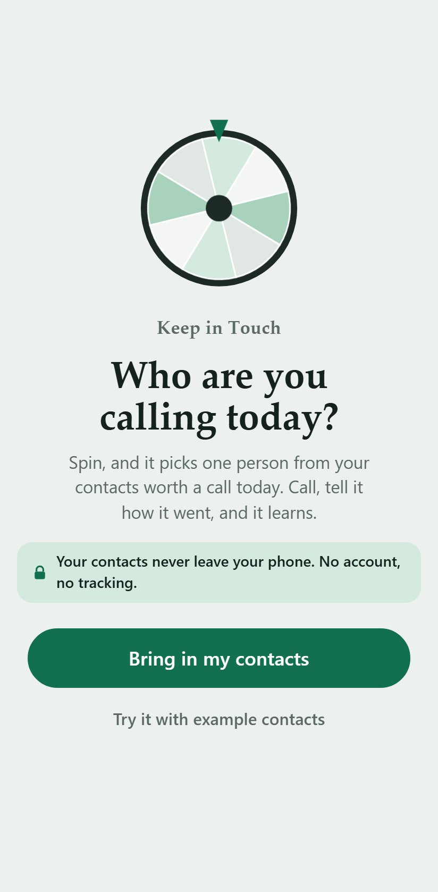
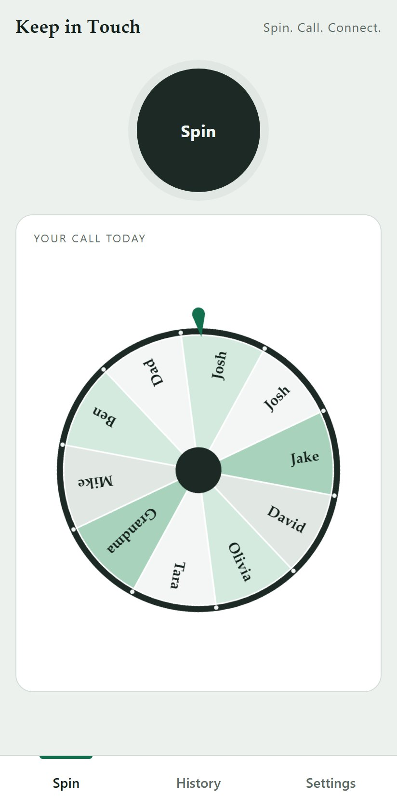
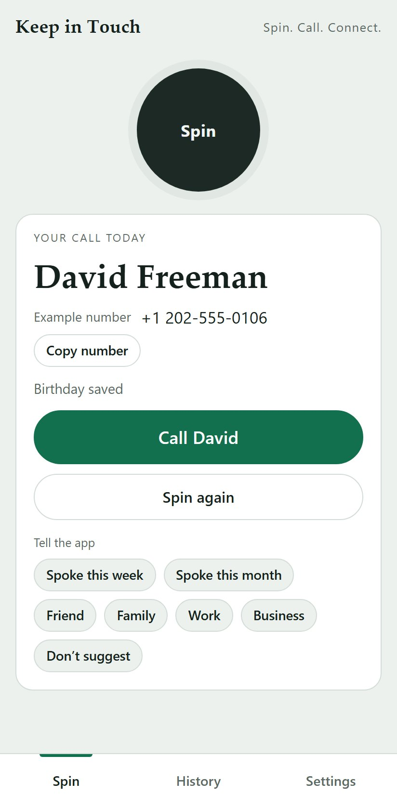

# Keep in Touch

[](https://github.com/duvsteinberg/keep-in-touch/actions/workflows/check.yml)
[](https://github.com/duvsteinberg/keep-in-touch/releases)
[](LICENSE)

**Spin. Call. Connect.** A small phone app that picks someone from your contacts to call today, learns from what you do, and keeps everything on your phone.

The app is not where the relationship happens. A good session is ten seconds in the app and a long conversation somewhere else.

**Open the app:** https://duvsteinberg.github.io/keep-in-touch/ · **Guide:** [the wiki](https://github.com/duvsteinberg/keep-in-touch/wiki) · **What changed:** [CHANGELOG.md](CHANGELOG.md) and [releases](https://github.com/duvsteinberg/keep-in-touch/releases)

<p align="center">
  
  
  
</p>
<p align="center"><sub>Shown with the app's invented example contacts.</sub></p>

## Status

A working prototype (v0.1.x) for a personal test, then a group of 10–12 testers for four weeks. It is not the finished product. Brand, the final interaction and a native Android app come after the test shows people actually call.

## Use it

**On Android** (Chrome):
1. Open https://duvsteinberg.github.io/keep-in-touch/ and tap **Install** (or ⋮ → **Add to home screen**).
2. Export your contacts as a `.vcf` file: Google Contacts app → **Fix & manage** → **Export to file**.
3. In the app, tap **Bring in contacts** and choose that file.

**On iPhone** (Safari):
1. Open the address in **Safari**, tap **Share** → **Add to Home Screen**, and from then on open it only from that icon.
2. Export your contacts: **Contacts** → **Lists** → press and hold **All iCloud** → **Export** → **Save to Files**.
3. In the app, tap **Bring in contacts** and choose that file.

**Every day:** tap **Spin**. Tap **Call**, then say whether you talked and whether you'd have called anyway. **Spin again** gives a quick new pick. Press and hold either one for a fun spin. The wiki has the full guide.

## License

The code is public so anyone can read it and check how the app treats their data, but it is not open source: all rights are reserved. The app itself is free to use. See [LICENSE](LICENSE).

## Privacy

Your contacts and everything the app learns stay in your browser on your device. No account, no tracking, no ads, no third-party code or fonts, and the browser itself enforces that the page talks to no other site. See [PRIVACY.md](PRIVACY.md). Security issues: [SECURITY.md](SECURITY.md).

## How it works

[ENGINE.md](ENGINE.md) describes the engine: duplicate merging, the day-one guess, the weighted pick with exploration, and what it learns from each tap. [sim/SIM-REPORT.md](sim/SIM-REPORT.md) has the simulation results.

## Building and checking

Plain Node.js, no dependencies.

```
node build.js              # builds index.html, manifest.webmanifest, sw.js, keep-in-touch.html
node --test test/test.js   # engine tests
node sim/simulate.js       # simulation on fake contact books (about 3 minutes)
node check/fixture.js && node check/page-check.js   # app check on an emulated Android phone (needs Playwright)
KIT_PHONE=iphone node check/page-check.js           # the same on an emulated iPhone, in Safari's engine
node check/no-personal-data.js   # no contact exports or backups in the repo
node check/store-images.js       # remakes the link preview and install screenshots in assets/ (after the look changes)
```

GitHub runs all of these except the simulation on every pull request, and `main` only accepts pull requests whose check is green.

Source lives in `src/`. `index.html` is generated: change `src/` and rebuild.

## License

No license yet: all rights reserved.
